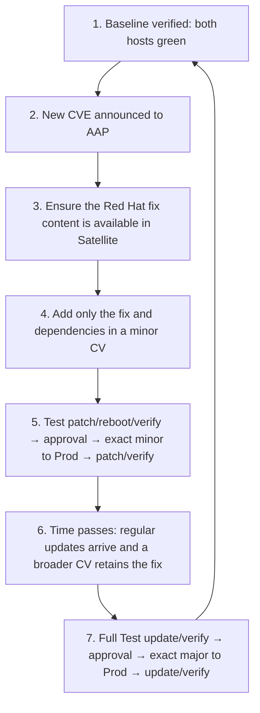

# RHEL sniperpatching cycle

[Open the interactive two-cycle mockup](https://kvegh.github.io/RHEL-sniperpatching/)
or read its [controls, source mapping and test scope](../demo/README.md).
The diagram below is the compact reference sequence.

An operator supplies a CVE or RHSA to Ansible Automation Platform (AAP). AAP
queries Satellite, prepares the selected fix in a minor Content View (CV)
version and patches Test. After successful verification, the operator decides
whether to continue to Prod using that exact tested version. A later broader
update repeats the Test-to-Prod sequence with all content through a chosen date.

The approval diamonds below are operator decisions between separately launched
AAP stages. The repository does not implement automatic approval prompts or a
scheduler. The date is a content cutoff supplied to the full-update stage, not
an automatic launch time. Wait for each stage to succeed before continuing.

These are the page's seven main scenes, repeated for both fixed CVE examples.
Scenes 5 and 7 unfold through separate presenter-controlled rollout actions.
Both hosts finish green before the next alert. Future CVEs stay hidden until
announced; a previously fixed issue remains Fixed during broader maintenance.
The Red Hat lane contrasts the selected fix/dependencies with bulk routine content.

The targeted path uses already synchronized content. The broader publication
explicitly synchronizes the selected repositories. The page explains these
responsibilities without adding a per-CVE sync job or automatic host discovery;
actual host scope remains the explicitly selected Test/Prod pair.

A CVE can resolve to several RHSAs. Supply one RHSA when exactly one advisory
is required. A minor update includes the selected advisory content and required
dependencies; it can change several RPM packages. Prod reuses the tested minor
rather than creating another version.

The broader cutoff includes security, bug-fix and enhancement content from the
configured repositories through that date. It preserves the earlier fix and
updates the remaining applicable packages. Same-day RHSAs cannot be separated
by a calendar-date cutoff. Incremental candidates enter Library and then Test
only after content validation. Production receives the exact version already
serving Test; force promotion is not used.

Publishing or promoting a CV changes available content. The separate host job
installs and verifies packages. Resetting a CV does not downgrade installed RPMs.
The independent read-only check can also run separately from a complete cycle.

On failure or an ambiguous result, stop and inspect the actual job and returned
CV version before continuing; retain evidence and any publication candidate.
See [recovery instructions](operations.md#recovery-and-repeat-behavior).
This diagram documents the process; current OLD/NEW verification boundaries
remain in the [presenter guide](../README.md#old-and-new-tracks).

Return to the [quick guide](../TLDR.md) or [presenter instructions](../README.md).
