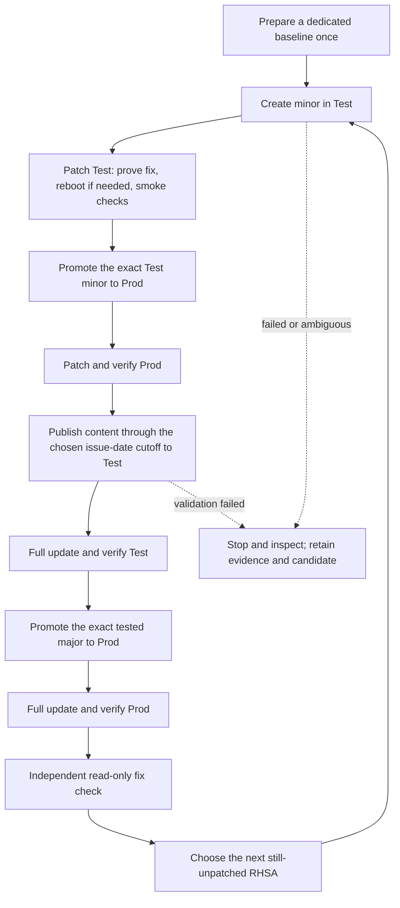

# Manual demonstration sequence

Every box below is a human-launched AAP stage. Arrows show the order to follow;
they do not configure automatic launches, production approvals or a scheduler.
Use the same selected fix throughout one cycle. Inspect each actual job result
and its reported content version before launching the following stage.

The presenter sequence and final acceptance include the independent check.
Operators may also run it separately without performing a full cycle.

The cutoff includes all advisory types through that issue date. Same-day RHSAs
cannot be separated by a calendar-date cutoff. Incremental candidates enter
Library and then Test only after content validation. Production receives the
exact version already serving Test; force promotion is not used.

On failure, follow [recovery instructions](operations.md#recovery-and-repeat-behavior).
Publishing old content does not roll back installed packages. This diagram is
source-controlled and renders on GitHub; a separate GitHub Pages deployment has
not been configured or verified as part of this review.

Return to the [quick guide](../TLDR.md) or [presenter instructions](../README.md).
